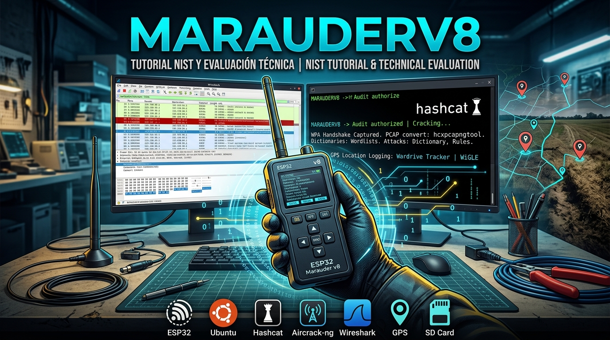

# MarauderV8

**NIST tutorial and technical evaluation / Tutorial NIST y evaluación técnica**

<p align="center">
  
</p>


Guía completa de auditoría WiFi con **ESP32 Marauder v8**, desde la instalación del firmware hasta el análisis forense con Wireshark y el cracking con Hashcat.

---

## 📑 Índice

### 🇪🇸 Castellano

- [🚀 Introducción](#-introducción)
- [🛠️ Instalación y configuración](#️-instalación-y-configuración)
- [📡 Captura de datos](#-captura-de-datos)
- [🔐 Análisis y cracking](#-análisis-y-cracking)
- [🗺️ Wardriving](#️-wardriving)
- [📚 Documentación del Marauder](#-documentación-del-marauder)
- [🛠️ Herramientas externas](#️-herramientas-externas)
- [🇬🇧 English Index](#-english-index)
- [⚖️ Uso legal](#️-uso-legal)

---

## 🚀 Introducción

Este repositorio documenta el flujo completo de una **auditoría WiFi autorizada** usando el **ESP32 Marauder v8** como herramienta de captura, y un PC con **Ubuntu** para el análisis y cracking.

**Flujo típico:**

```text
1. Instalar firmware en el Marauder
2. Capturar handshakes/PMKIDs con EAPOL/PMKID Scan
3. Convertir el pcap a formato Hashcat (hcxpcapngtool)
4. Crackear con Hashcat (diccionario, reglas, máscaras)
5. Analizar el tráfico con Wireshark (si se obtiene la clave)
6. Opcional: wardriving con GPS y análisis con Wardrive Tracker
```

---

## 🛠️ Instalación y configuración

- [Instalar o Actualizar el Firmware](docs/01-firmware.md)
- [Estructura de carpetas recomendada en la SD](docs/02-estructura-sd.md)

---

## 📡 Captura de datos

- [Cómo guardar datos desde el menú del Marauder v8](docs/03-captura-pcap.md#cómo-guardar-datos-desde-el-menú-del-marauder-v8)
- [📶 Wifi Captura de paquetes PCAP](docs/03-captura-pcap.md)
- [¿Cómo saber si tu `.pcap` sirve? (El Handshake)](docs/04-handshake.md)

---

## 🔐 Análisis y cracking

- [El Diccionario (Wordlist)](docs/05-wordlists.md)
- [Lanzar el ataque de comprobación con Aircrack-ng](docs/06-aircrack.md)
- [Lanzar el ataque Hashcat](docs/09-hashcat-para-atacar.md)
- [📊 Análisis con Wireshark](docs/10-wireshark.md)

---

## 🗺️ Wardriving

- [📡 Wardrive Tracker](docs/07-wardrive.md)
- [Instalación Wardrive Tracker](docs/08-instalacion-wardrive.md)

---

## 📚 Documentación del Marauder

Guía completa de todas las funciones del ESP32 Marauder v8, organizadas por módulo:

- [📡 ESP32 Marauder v8 — Documentación completa](docs/marauder/README.md)
  - [📶 WiFi](docs/marauder/wifi/README.md) — 63 archivos
    - [🔍 Sniffers](docs/marauder/wifi/sniffers/) — 17 herramientas de captura pasiva
    - [📡 Scanners](docs/marauder/wifi/scanners/) — 9 herramientas de descubrimiento activo
    - [⚔️ Attacks](docs/marauder/wifi/attacks/) — 17 herramientas ofensivas
    - [⚙️ General](docs/marauder/wifi/general/) — 16 herramientas de configuración
  - [🔵 Bluetooth](docs/marauder/bluetooth/README.md) — 25 archivos
    - [🔍 Sniffers](docs/marauder/bluetooth/sniffers/) — 6 herramientas de captura BLE
    - [📡 Scanners](docs/marauder/bluetooth/scanners/) — 3 herramientas de descubrimiento BLE
    - [⚔️ Attacks](docs/marauder/bluetooth/attacks/) — 8 ataques BLE
    - [⚙️ General](docs/marauder/bluetooth/general/) — 7 herramientas de configuración
  - [🛰️ GPS](docs/marauder/gps/README.md) — 22 archivos
    - [🔍 Info](docs/marauder/gps/info/) — 5 herramientas de diagnóstico GPS
    - [📡 Captura](docs/marauder/gps/captura/) — 5 herramientas de registro
    - [⚙️ Config](docs/marauder/gps/config/) — 6 herramientas de configuración
    - [📤 Export](docs/marauder/gps/export/) — 5 herramientas de exportación

---

## 🛠️ Herramientas externas

Herramientas usadas en el flujo de auditoría:

| Herramienta | Función | Doc |
|---|---|---|
| **hcxpcapngtool** | Convierte pcap a formato Hashcat | [docs/09-hashcat-para-atacar.md](docs/09-hashcat-para-atacar.md) |
| **Hashcat** | Crackea handshakes con GPU/CPU | [docs/09-hashcat-para-atacar.md](docs/09-hashcat-para-atacar.md) |
| **Aircrack-ng** | Alternativa a Hashcat, más simple | [docs/06-aircrack.md](docs/06-aircrack.md) |
| **Wireshark** | Análisis forense del tráfico | [docs/10-wireshark.md](docs/10-wireshark.md) |
| **Wardrive Tracker** | Análisis de logs WigleWifi en mapa | [docs/07-wardrive.md](docs/07-wardrive.md) |
| **hcxtools** | Utilidades para capturas WiFi | [docs/04-handshake.md](docs/04-handshake.md) |

---

## 🇬🇧 English Index

- [Install or Update Firmware (English)](docs/en/01-firmware.md)
- [Recommended folder structure (English)](docs/en/02-folder-structure.md)
- [How to save data from the Marauder v8 menu (English)](docs/en/03-save-data.md)

---

## ⚖️ Uso legal

Este repositorio documenta técnicas de **auditoría WiFi** con fines **educativos y de investigación**. Todo el contenido está pensado para usarse en:

- **Tu propia red**
- **Redes con autorización explícita por escrito** (pentest contratado)
- **Laboratorios aislados** (CTF, entornos de práctica)

**El uso de estas técnicas contra redes de terceros es delito** en España (art. 197 bis y 264 del Código Penal) y en la mayoría de jurisdicciones.

El **wardriving** (registrar redes con GPS) es legal en muchos países siempre que:

- **No te conectes** a las redes ajenas.
- **No inyectes tráfico** en ellas.
- **No las ataques** de ninguna forma.

**Wardriving responsable**: usa solo para mapear y contribuir a WiGLE, nunca para atacar.

---

## 🔗 Recursos relacionados

- [Repositorio oficial del ESP32 Marauder](https://github.com/justcallmekoko/ESP32Marauder)
- [Wiki oficial del Marauder](https://github.com/justcallmekoko/ESP32Marauder/wiki)
- [WiGLE — Base de datos mundial de redes WiFi](https://wigle.net/)
- [Hashcat — Documentación oficial](https://hashcat.net/hashcat/)
- [Wireshark — Documentación oficial](https://www.wireshark.org/docs/)
- [Aircrack-ng — Documentación oficial](https://www.aircrack-ng.org/documentation.html)

---

## 📄 Licencia

Este proyecto está bajo licencia **MIT**. Consulta el archivo [LICENSE](LICENSE) para más detalles.

---

## 🙏 Créditos

- **ESP32 Marauder** — proyecto original de [justcallmekoko](https://github.com/justcallmekoko/ESP32Marauder) bajo licencia GPL v3. Esta documentación es independiente y solo describe su uso.
- **WiGLE** — base de datos mundial de redes WiFi ([wigle.net](https://wigle.net/)).
- **Hashcat** — herramienta de cracking ([hashcat.net](https://hashcat.net/)).
- **Wireshark** — analizador de tráfico ([wireshark.org](https://www.wireshark.org/)).
- **Aircrack-ng** — suite de auditoría WiFi ([aircrack-ng.org](https://www.aircrack-ng.org/)).
