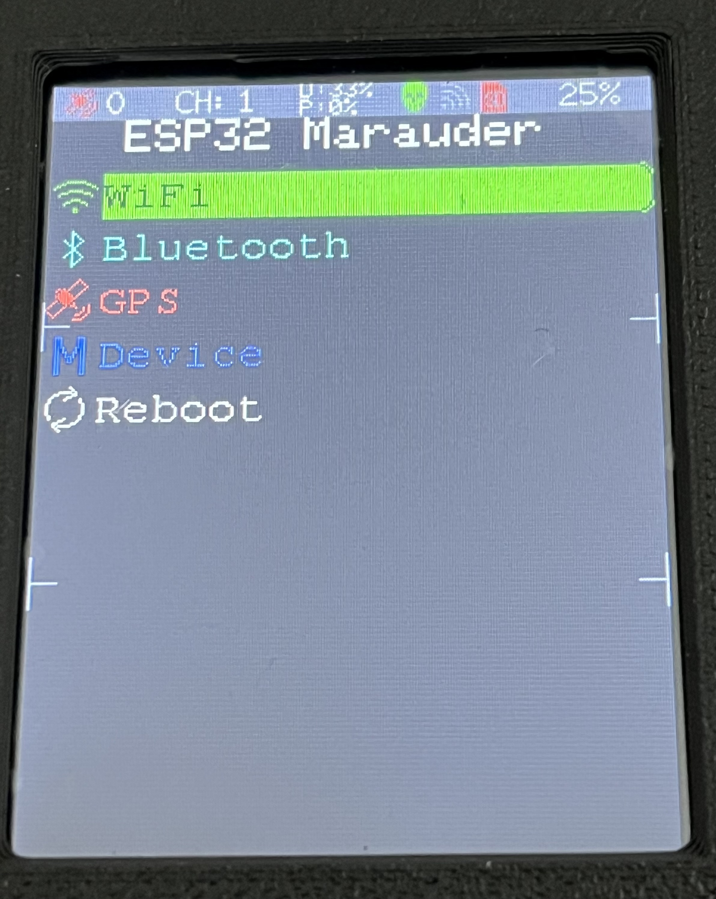
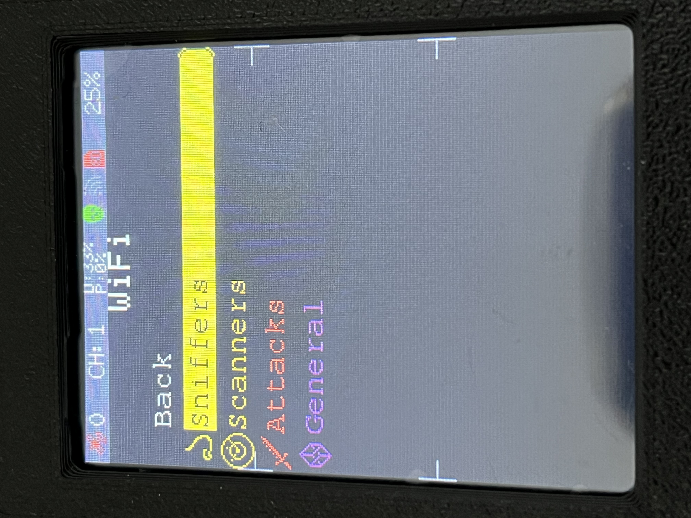
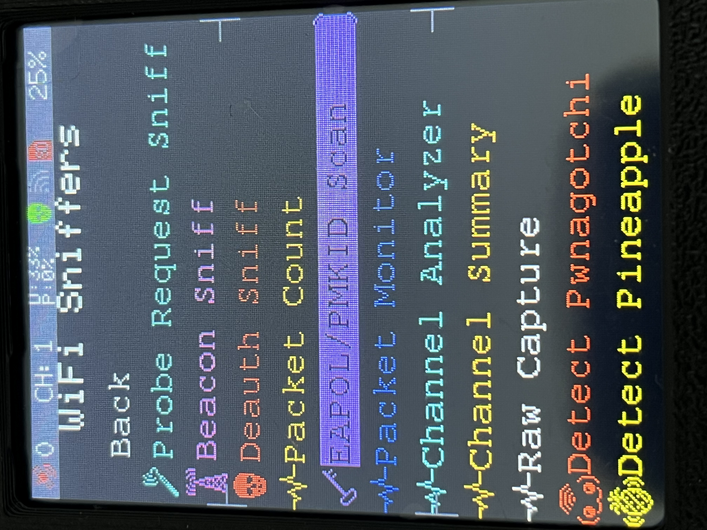
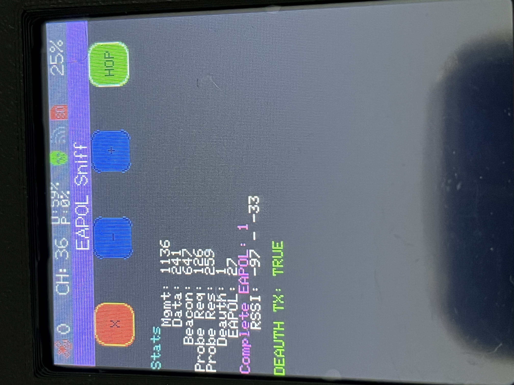

# 📶 Captura de paquetes WiFi (pcap) con el Marauder

[⬅️ Volver al índice](../README.md)

---

Un **archivo PCAP** (abreviatura de *Packet Capture*) es un formato estándar que contiene la grabación de todo el tráfico de datos transmitido a través de una red inalámbrica o de cable durante un periodo de tiempo. Funciona esencialmente como un "registro" o "vídeo" de lo que ha viajado por el aire: direcciones MAC, tramas de gestión y paquetes de datos.

En el contexto de la seguridad Wi-Fi, los archivos PCAP son fundamentales para analizar protocolos de red y entender el funcionamiento de intercambios de autenticación como el **WPA Handshake**.

---

## ¿Qué es un WPA Handshake (4-Way Handshake)?

Cuando un dispositivo (como un teléfono o portátil) se conecta a un router Wi-Fi protegido con WPA2 o WPA3, ambos intercambian **4 mensajes clave** antes de permitir la navegación. Este proceso de 4 pasos se conoce como *4-Way Handshake*.

- **Su función:** Permite que el router y el cliente demuestren que conocen la contraseña correcta y deriven las claves de cifrado temporales para la sesión, **sin enviar la contraseña real por el aire**.
- **Contenido de la captura:** El archivo PCAP registrado por un sniffer (como la Marauder) guarda esos 4 mensajes. Dentro de ellos viajan números aleatorios (*nonces*) y un código de autenticación (*MIC*).

---

## Plan completo para exprimir el WiFi

El Marauder tiene **53 herramientas WiFi**. Esta guía las recorre todas en **5 fases**, de menos a más complejidad.

```text
Fase 1: Sniffers básicos       → ver qué hay (pasivo)
Fase 2: Sniffers avanzados     → detectar anomalías (pasivo)
Fase 3: Scanners               → descubrir servicios (activo)
Fase 4: Attacks avanzados      → manipular la red (ofensivo)
Fase 5: Análisis avanzado      → procesar los datos (PC)
```

Cada fase se detalla a continuación.

---

## Fase 1: Sniffers básicos

Herramientas **pasivas** para ver qué hay en el aire. Son el primer paso de cualquier auditoría.

### 1.1. Beacon Sniff — Inventario de redes

**Qué hace:** captura los beacons que emiten los APs. Muestra SSID, BSSID, canal, cifrado y RSSI.

**Cómo se usa:**
1. Ve a **WiFi → Sniffers → Beacon Sniff**.
2. Pulsa **Start**.
3. Espera 30-60 segundos.
4. Anota el **BSSID** y el **canal** de tu red objetivo.
5. Pulsa **Stop**.

**Salida típica:**
```text
SSID                BSSID               CH  ENC   RSSI
MiFibra-BB6F        FA:8F:CA:61:05:78   6   WPA2  -67
Movistar_5G         00:1A:2B:3C:4D:5E   44  WPA2  -72
FreeWiFi            8C:1A:BF:9D:8E:7F   11  Open  -80
```

> 💡 **Tip:** si tienes muchas redes, filtra por tu SSID. Anota el **BSSID** (MAC), no solo el nombre, porque puede haber varias redes con el mismo SSID.

### 1.2. Probe Request Sniff — Inventario de dispositivos

**Qué hace:** captura los probe requests que emiten los clientes (móviles, portátiles) buscando redes conocidas. Revela qué dispositivos hay y qué redes buscan.

**Cómo se usa:**
1. Ve a **WiFi → Sniffers → Probe Request Sniff**.
2. Pulsa **Start**.
3. Espera 60-120 segundos.
4. Verás MACs (a menudo aleatorias) y SSIDs buscados.
5. Pulsa **Stop**.

**Salida típica:**
```text
MAC                 SSID                    CH  RSSI
3C:5A:B4:12:34:56   MiFibra-BB6F            6   -65
A4:83:E7:11:22:33   Movistar_5G             44  -70
FA:8F:CA:61:05:78   (wildcard)              1   -75
```

> 💡 **Tip:** muchas MACs empiezan por `FA`, `F2`, `F6` → son **MACs aleatorias** (privacidad de iOS/Android). No es un error.

### 1.3. Channel Analyzer — Elegir el mejor canal

**Qué hace:** muestra un gráfico de barras con la energía WiFi en cada canal. Te dice qué canal está más saturado y cuál está libre.

**Cómo se usa:**
1. Ve a **WiFi → Sniffers → Channel Analyzer**.
2. Pulsa **Start**.
3. Verás un gráfico tipo:
   ```text
   Canal  Energía
     1    ████████░░░░░░░░  -45 dBm
     2    ███░░░░░░░░░░░░░  -65 dBm
     6    ████████████████  -35 dBm  ← más saturado
    11    ████████████░░░░  -42 dBm
   ```
4. Pulsa **Stop**.

> 💡 **Tip:** en 2.4 GHz, los canales **1, 6 y 11** son los únicos que no se solapan. Si uno está saturado, prueba otro.

### 1.4. Packet Monitor — Tráfico en tiempo real

**Qué hace:** muestra contadores por tipo de trama (beacon, data, EAPOL, deauth, etc.) y un gráfico de evolución temporal.

**Cómo se usa:**
1. Ve a **WiFi → Sniffers → Packet Monitor**.
2. Pulsa **Start**.
3. Verás contadores y un gráfico tipo:
   ```text
   Beacon   ▁▂▃▄▅▆▇█▇▆▅▄▃▂▁▂▃▄▅▆▇█▇▆▅▄▃▂▁
   Data     ████████████████████████████████
   EAPOL    ▁▁▁▁▁▁▁▁▁▁▁▁▁▁▁▁▁▁▁▁▁▁▁▁▁▁▁▁▁▁
   ```
4. Pulsa **Stop**.

> 💡 **Tip:** si ves picos de **EAPOL**, hay reconexiones → buen momento para capturar handshakes.

### 1.5. Raw Capture — Capturar TODO

**Qué hace:** captura **todo** el tráfico 802.11 del canal actual, sin filtros. Genera un `.pcap` gigante con todo.

**Cómo se usa:**
1. Inserta la SD (obligatorio).
2. Ve a **WiFi → Sniffers → Raw Capture**.
3. Selecciona el canal.
4. Pulsa **Start**.
5. Espera el tiempo que quieras (1 min, 10 min, 1 hora).
6. Pulsa **Stop**.
7. El pcap se guarda en `/pcap/raw_XXXX.pcap`.

**Tamaño estimado:**
| Duración | Tamaño |
|---|---|
| 1 minuto | 1-5 MB |
| 10 minutos | 10-50 MB |
| 1 hora | 50-300 MB |

> 💡 **Tip:** úsalo cuando no sabes qué buscar. Luego analizas con Wireshark/tshark.

---

## 🔍 Fase 2: Sniffers avanzados

Herramientas **pasivas** para detectar anomalías, ataques o dispositivos específicos.

### 2.1. Deauth Sniff — Detectar ataques

**Qué hace:** detecta si alguien está lanzando **tramas de desautenticación** (deauth) en tu zona. Útil para saber si te están atacando o si hay interferencias.

**Cómo se usa:**
1. Ve a **WiFi → Sniffers → Deauth Sniff**.
2. Pulsa **Start**.
3. Si alguien lanza deauths, verás:
   ```text
   AP (spoofed):   FA:8F:CA:61:05:78
   Target STA:     3C:5A:B4:12:34:56
   Reason:         7 (Class 3 frame)
   RSSI:           -62
   ```
4. Pulsa **Stop**.

> 💡 **Tip:** el **código 7** es el típico de ataques con Marauder o `aireplay-ng`.

### 2.2. Detect MultiSSID — Detectar beacons spam

**Qué hace:** detecta cuando un **mismo dispositivo** emite **múltiples SSIDs diferentes**. Es la firma de un ataque de **Beacon Spam**.

**Cómo se usa:**
1. Ve a **WiFi → Sniffers → Detect MultiSSID**.
2. Pulsa **Start**.
3. Verás:
   ```text
   BSSID               SSIDs  Canal  SSIDs
   FA:8F:CA:61:05:78   5      6      MiFibra, FreeWiFi, HackMe, ...
   ```
4. Pulsa **Stop**.

> 💡 **Tip:** 2-3 SSIDs de una MAC es normal (router con red de invitados). 5+ es sospechoso.

### 2.3. MAC Monitor — Vigilar dispositivos

**Qué hace:** vigila **MACs específicas** y avisa cuando aparecen o desaparecen.

**Cómo se usa:**
1. Ve a **WiFi → Sniffers → MAC Monitor**.
2. Añade las MACs a vigilar.
3. Pulsa **Start**.
4. Verás:
   ```text
   3C:5A:B4:12:34:56   ✅ Presente    RSSI: -62    Canal: 6
   A4:83:E7:11:22:33   ❌ Ausente     —            —
   ```
5. Pulsa **Stop**.

> 💡 **Tip:** combínalo con **Fox Hunt** para localizar físicamente la MAC vigilada.

### 2.4. Fox Hunt — Localizar APs

**Qué hace:** localiza **físicamente** una señal WiFi mostrando su RSSI en tiempo real. Te mueves hacia donde la señal es más fuerte.

**Cómo se usa:**
1. Ve a **WiFi → Sniffers → Fox Hunt**.
2. Selecciona el **BSSID** o **SSID** objetivo.
3. Pulsa **Start**.
4. Muévete físicamente. El RSSI sube cuando te acercas.
5. Pulsa **Stop** cuando localices el AP.

> 💡 **Tip:** el RSSI fluctúa por reflexiones. Toma varias lecturas antes de decidir la dirección.

---

## Fase 3: Scanners

Herramientas **activas** que requieren que el Marauder esté **conectado a la red** (con **Join WiFi**).

### 3.1. Join WiFi — Conectar el Marauder

**Qué hace:** conecta el Marauder a una red WiFi como cliente. Necesario para usar los scanners.

**Cómo se usa:**
1. Ve a **WiFi → General → Join WiFi**.
2. Selecciona la red.
3. Introduce la contraseña.
4. Pulsa **Connect**.
5. Verás la IP asignada:
   ```text
   ✅ Conectado
   IP: 192.168.1.42
   Gateway: 192.168.1.1
   ```

### 3.2. Ping Scan — Descubrir hosts

**Qué hace:** envía pings a un rango de IPs para descubrir hosts vivos.

**Cómo se usa:**
1. Conecta el Marauder a la red (**Join WiFi**).
2. Ve a **WiFi → Scanners → Ping Scan**.
3. Introduce el rango (`192.168.1.0/24`).
4. Pulsa **Start**.
5. Verás los hosts vivos:
   ```text
   192.168.1.1     (router)
   192.168.1.5     (portátil)
   192.168.1.10    (móvil)
   ```

### 3.3. Port Scan All — Descubrir servicios

**Qué hace:** escanea los **65535 puertos TCP** de un host.

**Cómo se usa:**
1. Conecta el Marauder a la red.
2. Ve a **WiFi → Scanners → Port Scan All**.
3. Introduce la IP objetivo.
4. Pulsa **Start**.
5. Verás los puertos abiertos:
   ```text
   22    (SSH)
   80    (HTTP)
   443   (HTTPS)
   8080  (HTTP alternativo)
   ```

> ⚠️ **Lentitud:** escanear 65535 puertos tarda **~9 horas**. Reduce el rango si tienes prisa.

### 3.4. Scanners específicos

| Scanner | Puerto | Para qué |
|---|---|---|
| **SSH Scan** | 22 | Servidores SSH |
| **Telnet Scan** | 23 | Servidores Telnet (inseguro) |
| **SMTP Scan** | 25 | Servidores de correo |
| **DNS Scan** | 53 | Servidores DNS |
| **HTTP Scan** | 80 | Servidores web |
| **HTTPS Scan** | 443 | Servidores web seguros |
| **RDP Scan** | 3389 | Escritorios remotos |

**Cómo se usa (ejemplo con HTTP Scan):**
1. Conecta el Marauder a la red.
2. Ve a **WiFi → Scanners → HTTP Scan**.
3. Introduce el rango.
4. Pulsa **Start**.
5. Verás:
   ```text
   192.168.1.1     "Router Admin Panel" (nginx)
   192.168.1.15    "HP LaserJet" (HP)
   192.168.1.20    "Synology NAS" (nginx)
   ```

---

## Fase 4: Attacks avanzados

Herramientas **ofensivas**. **Solo para tu propia red o con autorización escrita.**

### 4.1. Deauth Targeted — Forzar reconexión

**Qué hace:** desconecta a **un cliente específico** para que se reconecte y genere un handshake.

**Cómo se usa:**
1. Escanea con **Scan AP/STA** para identificar AP y clientes.
2. Ve a **WiFi → Attacks → Deauth Targeted**.
3. Selecciona el AP y el cliente.
4. Pulsa **Start**.
5. **Inmediatamente** ve a **EAPOL/PMKID Scan** y captura.

> ⚠️ **Solo para tu red.** Un deauth a redes ajenas es delito.

### 4.2. Deauth Flood — Tumbar toda la red

**Qué hace:** desconecta a **todos los clientes** de un AP. Más invasivo que el targeted.

**Cómo se usa:**
1. Ve a **WiFi → Attacks → Deauth Flood**.
2. Selecciona el AP.
3. Pulsa **Start**.
4. Todos los clientes se desconectan.

> ⚠️ **Muy invasivo.** Solo en tu red o con autorización.

### 4.3. Beacon Spam List — Emitir beacons falsos

**Qué hace:** emite beacons falsos con SSIDs de una lista. Satura el espectro.

**Cómo se usa:**
1. Ve a **WiFi → General → Add SSIDs** para crear la lista.
2. Ve a **WiFi → Attacks → Beacon Spam List**.
3. Pulsa **Start**.
4. Cientos de redes falsas aparecen en los dispositivos cercanos.

> ⚠️ **Interferencia.** Delito si afecta a redes ajenas.

### 4.4. Probe Req Flood — Inundar con probes

**Qué hace:** inunda el aire con probe requests falsos. Satura los APs cercanos.

**Cómo se usa:**
1. Ve a **WiFi → Attacks → Probe Req Flood**.
2. Pulsa **Start**.
3. Miles de probes por segundo.

### 4.5. AP Clone Spam — Clonar un AP

**Qué hace:** clona un AP legítimo (mismo SSID, BSSID, canal). Los clientes pueden confundirse.

**Cómo se usa:**
1. Escanea con **Beacon Sniff** para identificar el AP.
2. Ve a **WiFi → Attacks → AP Clone Spam**.
3. Introduce SSID, BSSID y canal del AP original.
4. Pulsa **Start**.

> ⚠️ **Suplantación de identidad.** Delito.

### 4.6. Evil Portal — Portal captive falso

**Qué hace:** levanta un AP falso con un portal captive para **phishing**. Los clientes ven una página falsa que les pide credenciales.

**Cómo se usa:**
1. Prepara el HTML y cópialo a `/portals/` en la SD.
2. Ve a **WiFi → General → Select EP HTML File** y selecciónalo.
3. Ve a **WiFi → Attacks → Evil Portal**.
4. Pulsa **Start**.
5. Los clientes que se conecten verán tu HTML falso.

> ⚠️ **Phishing.** Delito grave. Solo con autorización escrita.

### 4.7. Karma — Responder a probes

**Qué hace:** responde a los probe requests de los clientes haciéndose pasar por la red que buscan.

**Cómo se usa:**
1. Ve a **WiFi → Attacks → Karma**.
2. Pulsa **Start**.
3. Los clientes que busquen redes conocidas se conectarán al Marauder.

> ⚠️ **Suplantación.** Delito.

---

## 💻 Fase 5: Análisis avanzado (PC)

Una vez tienes los pcaps, los analizas en el PC.

### 5.1. Wireshark avanzado

**Qué hace:** análisis detallado de los pcaps.

**Filtros útiles:**
```text
eapol                          → handshake
wlan.fc.type_subtype == 0x08   → beacons
wlan.fc.type_subtype == 0x04   → probe requests
wlan.fc.type_subtype == 0x0c   → deauths
wlan.addr == XX:XX:XX:XX:XX:XX → tráfico de una MAC
ip || arp || dns || http       → tráfico descifrado
```

**Estadísticas:**
- **Statistics → Capture File Properties** → resumen del pcap.
- **Statistics → Protocol Hierarchy** → protocolos por capa.
- **Statistics → Conversations** → conversaciones entre MACs.
- **Statistics → Endpoints** → dispositivos.

**Gráficos:**
- **Statistics → I/O Graph** → tráfico por segundo.
- **Statistics → Flow Graph** → flujo de paquetes.

Ver [Análisis con Wireshark](10-wireshark.md) para más detalle.

### 5.2. tshark scripting

**Qué hace:** automatizar el análisis de pcaps desde la terminal.

**Comandos útiles:**
```bash
# Ver todos los EAPOL
tshark -r eapol_0.pcap -Y eapol

# Ver beacons con SSID, canal y cifrado
tshark -r eapol_0.pcap -Y "wlan.fc.type_subtype == 0x08" \
  -T fields -e wlan.bssid -e wlan.ssid -e wlan_radio.channel

# Contar tramas por tipo
tshark -r eapol_0.pcap -q -z io,phs

# Extraer todos los SSIDs únicos
tshark -r eapol_0.pcap -Y "wlan.fc.type_subtype == 0x08" \
  -T fields -e wlan.ssid | sort -u

# Seguir un flujo TCP (si está descifrado)
tshark -r eapol_0.pcap -q -z follow,tcp,ascii,0
```

**Script de ejemplo (bash):**
```bash
#!/bin/bash
# Extrae SSIDs y BSSIDs de un pcap
PCAP=$1
tshark -r "$PCAP" -Y "wlan.fc.type_subtype == 0x08" \
  -T fields -e wlan.bssid -e wlan.ssid -e wlan_radio.channel \
  | sort -u > redes.txt
echo "Redes extraídas: $(wc -l < redes.txt)"
```

### 5.3. Python con scapy

**Qué hace:** manipular paquetes, crear herramientas personalizadas.

**Ejemplo: leer un pcap y contar EAPOL**
```python
from scapy.all import rdpcap, EAPOL

packets = rdpcap("eapol_0.pcap")
eapol_count = sum(1 for p in packets if p.haslayer(EAPOL))
print(f"Paquetes EAPOL: {eapol_count}")
```

**Ejemplo: extraer SSIDs**
```python
from scapy.all import rdpcap, Dot11Beacon, Dot11Elt

packets = rdpcap("eapol_0.pcap")
ssids = set()
for p in packets:
    if p.haslayer(Dot11Beacon):
        ssid = p[Dot11Elt].info.decode(errors='ignore')
        ssids.add(ssid)
print(f"SSIDs únicos: {len(ssids)}")
for ssid in sorted(ssids):
    print(f"  - {ssid}")
```

Ver la [documentación de Scapy](https://scapy.readthedocs.io/) para más.

---

## Flujo completo para capturar un PCAP útil

Resumen del flujo para capturar un handshake:

```text
1. Preparar el Marauder (SD, firmware)
2. Escanear redes       → Beacon Sniff / Scan AP/STA
3. Identificar el AP    → anotar BSSID y canal
4. Identificar clientes → anotar MACs
5. Capturar handshake   → EAPOL/PMKID Scan
6. (Si no hay) forzar   → Deauth Targeted
7. Verificar el pcap    → aircrack-ng
8. Transferir al PC     → copiar a ~/Documents/.../pcap/
```

### Checklist rápido

```text
[ ] SD formateada en FAT32 con /pcap/ y /logs/
[ ] Firmware actualizado
[ ] Beacon Sniff → anotar BSSID y canal
[ ] Scan AP/STA → anotar MACs de clientes
[ ] EAPOL/PMKID Scan → capturar handshake
[ ] (Si no hay) Deauth Targeted → forzar reconexión
[ ] Verificar con aircrack-ng → "1 handshake"
[ ] Copiar pcap al PC
```

### Errores comunes

| Error | Causa | Solución |
|---|---|---|
| `0 handshake` en aircrack-ng | No se capturó el handshake | Volver al Paso 5 o 6 |
| `Packets contained no EAPOL data` | El pcap no tiene EAPOL | Volver al Paso 5 |
| `No such file or directory` | El pcap no está en la ruta | Verificar la SD y la ruta |
| El pcap está vacío | El Marauder no capturó nada | Verificar el canal y la SD |
| El deauth no funciona | Red WPA3 o PMF | No hay solución, WPA3 no es crackeable |

---

## Captura de paquetes (Handshakes / PCAP)

- Ve a **WiFi** > **Sniffers** > **EAPOL/PMKID Scan** (o **PKE / Handshake**).
- Al pulsar **Start**, el archivo `.pcap` se escribirá directamente en la carpeta `/pcap` de la tarjeta SD.

| | | | |
|:---:|:---:|:---:|:---:|
|  |  |  |  |
| Selección de menú | Modo sniffer | EAPOL/PMKID Scan | Capturando paquetes |

---

## Análisis defensivo y auditoría con Wireshark en Ubuntu

Para inspeccionar y analizar capturas PCAP en un entorno de laboratorio o auditoría de red propia, se utiliza **Wireshark**.

### 1. Instalación de Wireshark en Ubuntu

Abre la terminal e instala la herramienta:

```bash
sudo apt update
sudo apt install wireshark -y
```

*(Opcional: Durante la instalación, si pregunta si los usuarios no superusuarios deben poder capturar paquetes, selecciona "Sí" y añade tu usuario al grupo `wireshark` con `sudo usermod -aG wireshark $USER`).*

### 2. Inspeccionar la captura PCAP con Wireshark

1. Copia el archivo `.pcap` generado por la tarjeta SD a tu equipo Ubuntu.
2. Abre el archivo en Wireshark:

```bash
wireshark /ruta/a/tu/archivo.pcap
```

3. **Filtros útiles en Wireshark:**
   - Para ver únicamente los paquetes del intercambio de autenticación (*Handshake*):
     ```text
     eapol
     ```
   - Si deseas ver únicamente las tramas de gestión de una red o cliente específico por su dirección MAC:
     ```text
     wlan.addr == XX:XX:XX:XX:XX:XX
     ```

Si el filtro `eapol` muestra los 4 mensajes (o al menos los pares necesarios 1-2 o 2-3), significa que la captura del Handshake se ha realizado correctamente y está completa para su análisis.

---

## 🔗 Relacionado

- [¿Cómo saber si tu `.pcap` sirve? (El Handshake)](04-handshake.md)
- [El Diccionario (Wordlist)](05-wordlists.md)
- [Lanzar el ataque de comprobación con Aircrack-ng](06-aircrack.md)
- [Lanzar el ataque Hashcat](09-hashcat-para-atacar.md)
- [📊 Análisis con Wireshark](10-wireshark.md)
- [Documentación Marauder — WiFi](marauder/wifi/README.md)
- [EAPOL/PMKID Scan](marauder/wifi/sniffers/eapol-pmkid.md)
- [Deauth Targeted](marauder/wifi/attacks/deauth-targeted.md)
- [Beacon Sniff](marauder/wifi/sniffers/beacon.md)
- [Scan AP/STA](marauder/wifi/sniffers/scan-ap-sta.md)
- [Probe Request Sniff](marauder/wifi/sniffers/probe-request.md)
- [Channel Analyzer](marauder/wifi/sniffers/channel-analyzer.md)
- [Raw Capture](marauder/wifi/sniffers/raw-capture.md)
- [Deauth Sniff](marauder/wifi/sniffers/deauth.md)
- [Detect MultiSSID](marauder/wifi/sniffers/detect-multissid.md)
- [MAC Monitor](marauder/wifi/sniffers/mac-monitor.md)
- [Fox Hunt](marauder/wifi/sniffers/fox-hunt.md)
- [Ping Scan](marauder/wifi/scanners/ping-scan.md)
- [Port Scan All](marauder/wifi/scanners/port-scan-all.md)
- [SSH Scan](marauder/wifi/scanners/ssh-scan.md)
- [HTTP Scan](marauder/wifi/scanners/http-scan.md)
- [HTTPS Scan](marauder/wifi/scanners/https-scan.md)
- [RDP Scan](marauder/wifi/scanners/rdp-scan.md)
- [Beacon Spam List](marauder/wifi/attacks/beacon-spam-list.md)
- [Probe Req Flood](marauder/wifi/attacks/probe-req-flood.md)
- [Deauth Flood](marauder/wifi/attacks/deauth-flood.md)
- [AP Clone Spam](marauder/wifi/attacks/ap-clone-spam.md)
- [Evil Portal](marauder/wifi/attacks/evil-portal.md)
- [Karma](marauder/wifi/attacks/karma.md)
- [Join WiFi](marauder/wifi/general/join-wifi.md)
- [Set MACs](marauder/wifi/general/set-macs.md)