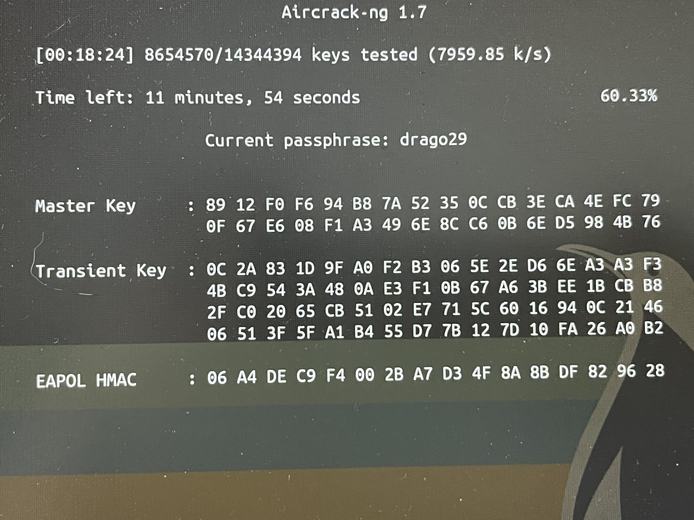

# Lanzar el ataque de comprobación con Aircrack-ng

[⬅️ Volver al índice](../README.md)

---

## ¿Qué es Aircrack-ng?

**Aircrack-ng** es una suite de herramientas para auditoría WiFi que incluye:

- **`aircrack-ng`**: crackea handshakes WPA/WPA2 con diccionario.
- **`airmon-ng`**: gestiona el modo monitor.
- **`airodump-ng`**: captura tráfico WiFi.
- **`aireplay-ng`**: inyecta tráfico (deauth, etc.).

En este documento nos centramos en **`aircrack-ng`**, la herramienta de cracking por diccionario.

---

## Ataque de fuerza bruta con diccionario

Cuando tengas tu archivo `.pcap` con el handshake verificado (ver [¿Cómo saber si tu `.pcap` sirve?](04-handshake.md)) y tu diccionario listo (ver [El Diccionario](05-wordlists.md)), el comando en la terminal de Ubuntu para probar si la clave está en la lista es:

```bash
aircrack-ng -w ~/path/path/worldlist/rockyou.txt \
  -b XX:XX:XX:XX:XX:XX \
  path/path/pcap/eapol_0.pcap
```

*(Sustituye `XX:XX:XX:XX:XX:XX` por la dirección MAC del router/Access Point que capturaste y ajusta las rutas según la ubicación de tus archivos).*

---

## Descripción de los parámetros utilizados

| Flag | Descripción |
|---|---|
| **`-w`** | Especifica la ruta absoluta o relativa hacia el archivo de diccionario (`wordlist`), como por ejemplo `rockyou.txt`, que contiene las contraseñas candidatas a probar. |
| **`-b`** | Define el **BSSID** (dirección MAC) del punto de acceso objetivo para filtrar de forma estricta el tráfico correspondiente a esa red en concreto. |
| **Ruta del `.pcap`** | El archivo de captura generado por el ESP32 Marauder (almacenado inicialmente en la raíz de la SD y movido a tu equipo) que incluye el **4-Way Handshake** validado (`1 handshake` detectado). |

### Flags adicionales útiles

| Flag | Para qué |
|---|---|
| **`-e`** | Especifica el ESSID (nombre de la red) en lugar del BSSID. |
| **`-l`** | Guarda la clave encontrada en un archivo. |
| **`-M`** | Número de hilos (para CPUs multinúcleo). |
| **`-q`** | Modo silencioso (sin barra de progreso). |
| **`-a 2`** | Fuerza el modo WPA2 (por defecto lo detecta). |

---

## Posibles resultados en pantalla

### 1. Éxito (`KEY FOUND!`)

Si la contraseña real de la red se encuentra dentro del diccionario probado, el proceso se detendrá de inmediato y mostrará un recuadro con la clave en texto plano:

```text
                              KEY FOUND! [ MiFibra2026 ]

      Master Key     : 4A 3B 2C 1D 0E 9F 8E 7D 6C 5B 4A 39 28 17 06 F5
                       E4 D3 C2 B1 A0 9F 8E 7D 6C 5B 4A 39 28 17 06 F5

      Transient Key  : 1A 2B 3C 4D 5E 6F 7A 8B 9C AD BE CF D0 E1 F2 03
                       ...

      EAPOL HMAC     : 8F 7E 6D 5C 4B 3A 29 18 07 F6 E5 D4 C3 B2 A1 90
```

### 2. Fracaso (`Key not found`)

Si el contador llega al 100% o finaliza el archivo sin éxito:

```text
                               Aircrack-ng 1.7

      [00:34:56] 14344387/14344387 keys tested (7243.12 k/s)

      Time left: 0 seconds                                      100%

                           KEY NOT FOUND

      Master Key     : (not found)
      Transient Key  : (not found)
      EAPOL HMAC     : (not found)
```

Significa que la contraseña **no estaba** en el diccionario utilizado y se requerirá una wordlist más amplia o específica.

---

<p align="center">
  
  <br>
  <em>Aircrack-ng 1.7 — keys tested</em>
</p>

---

## ¿Por qué Aircrack-ng dice "Key not found"?

Es **normal**. `aircrack-ng` ha probado todas las contraseñas de tu `rockyou.txt` contra el handshake de tu red y ninguna ha coincidido. Esto **no significa que el handshake esté mal**, simplemente que la contraseña real de tu red **no está en esa lista de diccionario**.

El `rockyou.txt` es solo una recopilación de contraseñas filtradas y conocidas, **no una lista mágica** que lo contiene todo.

> 💡 **Buena noticia:** si tu contraseña no está en `rockyou.txt`, es que **no eres víctima de un ataque de diccionario básico**. Eso es **seguridad**.

---

## Siguiente paso: Hashcat

Aircrack-ng es útil para **pruebas rápidas** con diccionarios pequeños. Pero para ataques más potentes:

- **Hashcat** es mucho más rápido (usa GPU si tienes).
- **Hashcat** soporta reglas, máscaras e híbridos.
- **Hashcat** tiene modo `22000` que combina EAPOL + PMKID.

## 👉 [ACCEDER A LA GUÍA DE HASHCAT](09-hashcat-para-atacar.md)

---

## ⚠️ Advertencias

- **Legalidad:** solo puedes crackear handshakes de **tu propia red** o de redes con **autorización explícita por escrito**.
- **Velocidad:** aircrack-ng en CPU es lento. Para diccionarios grandes (>10M), usa Hashcat.
- **CPU vs GPU:** aircrack-ng no usa GPU. Hashcat sí.
- **Diccionario:** el resultado depende **100% del diccionario**. Si la contraseña no está, no la encuentra.
- **WPA3:** aircrack-ng **no puede crackear WPA3** (SAE). Solo WPA/WPA2.

---

## Comandos de referencia rápida

```bash
# Ataque básico con diccionario
aircrack-ng -w rockyou.txt -b XX:XX:XX:XX:XX:XX eapol_0.pcap

# Especificar ESSID en lugar de BSSID
aircrack-ng -w rockyou.txt -e "MiFibra-BB6F" eapol_0.pcap

# Guardar la clave encontrada en un archivo
aircrack-ng -w rockyou.txt -b XX:XX:XX:XX:XX:XX -l clave.txt eapol_0.pcap

# Usar múltiples hilos (CPU multinúcleo)
aircrack-ng -w rockyou.txt -b XX:XX:XX:XX:XX:XX -M 4 eapol_0.pcap

# Modo silencioso (sin barra de progreso)
aircrack-ng -w rockyou.txt -b XX:XX:XX:XX:XX:XX -q eapol_0.pcap
```

---

## 🔗 Relacionado

- [¿Cómo saber si tu `.pcap` sirve?](04-handshake.md)
- [El Diccionario (Wordlist)](05-wordlists.md)
- [Lanzar el ataque Hashcat](09-hashcat-para-atacar.md)
- [📊 Análisis con Wireshark](10-wireshark.md)
- [EAPOL/PMKID Scan (Marauder)](marauder/wifi/sniffers/eapol-pmkid.md)
- [Documentación oficial de Aircrack-ng](https://www.aircrack-ng.org/documentation.html)