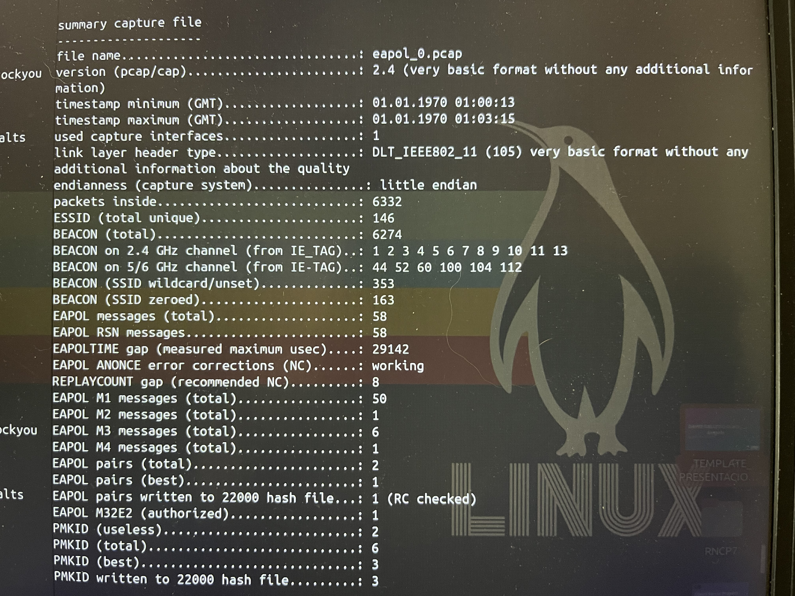
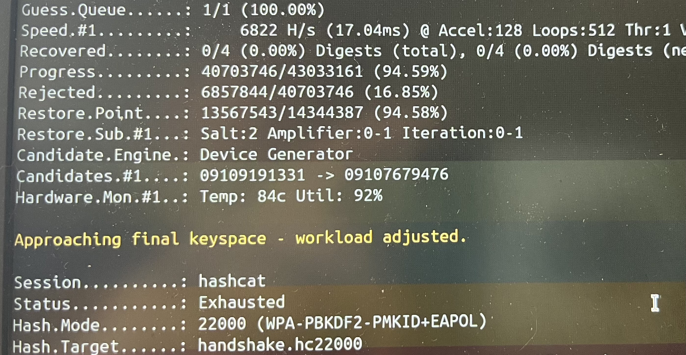

# Hashcat para atacar

[⬅️ Volver al índice](../README.md)

---

## Índice

- [Paso 1: Convertir el `.pcap` para Hashcat](#-paso-1-convertir-el-pcap-para-hashcat)
- [Paso 2: Interpretación del análisis de captura](#-paso-2-interpretación-del-análisis-de-captura)
- [Paso 3: Lanzar Hashcat (modo 22000)](#-paso-3-lanzar-hashcat-modo-22000)
- [Paso 4: Lanzar Hashcat con reglas `best64.rule`](#-paso-4-lanzar-hashcat-con-reglas-best64rule)
- [Paso 5: Estrategias avanzadas](#-paso-5-estrategias-avanzadas)
- [Paso 6: Usar la contraseña en Wireshark](#-paso-6-usar-la-contraseña-en-wireshark)
- [Conclusión](#-conclusión)

---

Es exactamente el flujo profesional. Hashcat es mucho más rápido probando contraseñas (usa tu GPU) y Wireshark es la herramienta ideal para visualizar el tráfico una vez descifrado.

---

## 🟢 Paso 1: Convertir el `.pcap` para Hashcat

Hashcat **no lee `.pcap` directamente**. Necesitas extraer el handshake a un formato de texto. Lo más moderno es usar la herramienta `hcxpcapngtool` para generar un archivo en formato **hashcat 22000**.

```bash
# Instala hcxtools y hashcat si no los tienes
sudo apt install hcxtools -y
sudo apt install hashcat -y

# Convierte tu pcap al formato de hashcat
hcxpcapngtool -o handshake.hc22000 Documents/path/a/tu/pcap/eapol_0.pcap
```

Esto creará un archivo `handshake.hc22000` con el hash del handshake de tu red.

### Verificar el archivo

```bash
wc -l handshake.hc22000
head -1 handshake.hc22000
```

Deberías ver:
- **4 líneas** (1 EAPOL + 3 PMKID, por ejemplo).
- La primera línea empezando por `WPA*01*` (PMKID) o `WPA*02*` (EAPOL).

---

## 🟢 Paso 2: Interpretación del análisis de captura

Cuando usas `hcxpcapngtool` sobre un `.pcap`, obtienes un resumen con toda la información relevante de la captura. Estos son los campos que realmente importan para una auditoría WPA/WPA2.

<p align="center">
  
  <br>
  <em>hcxpcapngtool — Captured</em>
</p>

### Datos clave de la captura

| Campo | Valor | Significado |
|---|---|---|
| **file name** | `eapol_0.pcap` | Archivo analizado |
| **packets inside** | 6332 | Paquetes totales capturados |
| **link layer header type** | DLT_IEEE802_11 (105) | Captura 802.11 cruda, sin radiotap |
| **ESSID (total unique)** | 146 | 146 redes distintas detectadas |
| **BEACON (total)** | 6274 | Tramas de baliza (los AP emitiéndose) |

### Distribución de canales

- **2.4 GHz**: canales 1-11 y 13
- **5/6 GHz**: canales 44, 52, 60, 100, 104, 112

Captura amplia, con redes de ambas bandas. Típico de un wardrive o escaneo pasivo.

### Handshake WPA (lo importante)

| Campo | Valor | Significado |
|---|---|---|
| **EAPOL messages (total)** | 58 | Mensajes EAPOL capturados en total |
| **EAPOL M1** | 50 | 50 mensajes tipo 1 (AP → cliente) |
| **EAPOL M2** | 1 | **1 mensaje tipo 2 (cliente → AP) ← el clave** |
| **EAPOL M3** | 6 | 6 mensajes tipo 3 |
| **EAPOL M4** | 1 | 1 mensaje tipo 4 |
| **EAPOL pairs (best)** | 1 | **1 handshake completo y válido** ✅ |
| **EAPOL M32E2 (authorized)** | 1 | **Handshake autorizado** (la contraseña usada era correcta) |
| **EAPOL pairs written to 22000** | 1 | 1 handshake exportado a `.hc22000` |

> **Conclusión:** hay **1 handshake completo y utilizable** para atacar con Hashcat. El campo `M32E2 (authorized)` confirma que la autenticación se completó correctamente, así que el handshake es 100% válido.

### PMKID (vía alternativa)

| Campo | Valor | Significado |
|---|---|---|
| **PMKID (total)** | 6 | 6 PMKIDs capturados |
| **PMKID (best)** | 3 | 3 PMKIDs válidos |
| **PMKID written to 22000** | 3 | 3 exportados a `.hc22000` |

El **PMKID** es un identificador que el AP envía en el primer mensaje de asociación. Permite atacar la contraseña **sin necesidad del handshake completo**. Es más rápido y no requiere capturar el momento de conexión.

### Resultado final del análisis

El archivo `.hc22000` generado contiene:

- **1 handshake EAPOL** completo
- **3 PMKIDs** válidos

Todo listo para lanzar Hashcat con `-m 22000`.

### Avisos del análisis (no bloqueantes)

| Aviso | Impacto |
|---|---|
| `very basic format` | El pcap es clásico, no pcapng. No afecta al cracking |
| `radiotap header is missing` | Sin info de frecuencia/calidad. No afecta al cracking |
| `missing frames: proberequest` | No hay probe requests. Dificulta recuperar PSK en algunos casos |
| `missing frames: authentication/association` | No hay proceso de conexión completo. Solo afecta a Wireshark, no a Hashcat |

### Interpretación práctica

| Pregunta | Respuesta |
|---|---|
| ¿El pcap sirve para crackear? | **Sí**, tiene 1 handshake completo |
| ¿Sirve para descifrar tráfico en Wireshark? | **Parcialmente**, podrás descifrar datos pero no verás el proceso de conexión |
| ¿Cuántas redes distintas hay? | 146 |
| ¿Cuántos handshakes válidos? | 1 |
| ¿Cuántos PMKIDs? | 3 |
| ¿Se puede atacar con Hashcat? | **Sí**, modo `22000` |

### Resumen de la captura

- **146 redes** detectadas
- **1 handshake EAPOL completo** ✅
- **3 PMKIDs válidos** ✅
- **Todo exportado a** `handshake.hc22000`

**Listo para Hashcat:** `hashcat -m 22000 handshake.hc22000 wordlist.txt`

---

## 🟢 Paso 3: Lanzar Hashcat (modo 22000)

El comando básico para probar un diccionario es:

```bash
hashcat -m 22000 handshake.hc22000 /ruta/a/tu/wordlist.txt
```

| Flag | Significado |
|---|---|
| `-m 22000` | Indica a Hashcat que el hash es de tipo WPA-PBKDF2-PMKID+EAPOL |
| `handshake.hc22000` | El archivo que acabas de crear |
| `/ruta/a/tu/wordlist.txt` | Tu diccionario. Puedes usar el `rockyou.txt` completo o uno más específico |

Hashcat irá mostrando su progreso. Si la encuentra, te mostrará la contraseña en pantalla.

### Flags útiles

| Flag | Para qué |
|---|---|
| `-w 3` | Workload alto (más rápido, GPU al máximo) |
| `--status` | Muestra progreso en vivo |
| `--status-timer=10` | Actualiza cada 10 segundos |
| `--potfile-path=hashcat.potfile` | Guarda las claves encontradas en un archivo aparte |
| `--restore` | Reanuda un ataque interrumpido |
| `-r archivo.rule` | Aplica reglas de transformación |

### Atajos durante el ataque

| Tecla | Acción |
|---|---|
| `s` | Ver estado actual |
| `p` | Pausar |
| `r` | Reanudar |
| `b` | Saltar (bypass) |
| `q` | Salir (guarda progreso) |
| `c` | Checkpoint (guardar estado) |
| `f` | Terminar (finish) |

<p align="center">
  
  <br>
  <em>handshake.hc22000 — Status: Exhausted</em>
</p>

---

## 🟢 Paso 4: Lanzar Hashcat con reglas `best64.rule`

Si estamos aquí, es porque **Hashcat ha terminado con `Status: Exhausted`**, lo que significa que ha probado las 14.344.387 contraseñas de `rockyou.txt` **sin encontrar la tuya**. Esto es completamente esperado porque:

1. Tu contraseña es personalizada (no está en la lista de las más comunes).
2. `rockyou.txt` es solo una recopilación de filtraciones antiguas, no una lista mágica.

### Siguiente paso: Hashcat con reglas `best64.rule`

El comando (`-r best64.rule`) es exactamente el siguiente ataque lógico. Las reglas aplican **transformaciones** a cada palabra del diccionario, generando variantes como:

- `mifibra` → `MiFibra`, `MIFIBRA`, `mifibra1`, `mifibra2024`, `mifibra!`, etc.
- `casa` → `Casa123`, `casa2026`, `casa!`, etc.

### Comando a ejecutar

```bash
hashcat -m 22000 handshake.hc22000 ~/Mi/ruta/hacia/worldlist/rockyou.txt \
  -r /usr/share/hashcat/rules/best64.rule \
  -w 2
```

| Flag | Para qué |
|---|---|
| `-r /usr/share/hashcat/rules/best64.rule` | Aplica 64 transformaciones a cada palabra |
| `-w 2` | Workload medio (menos calor, más estable) |

### Tiempo estimado

Con reglas, Hashcat prueba **64 variantes por cada palabra**. Eso multiplica el trabajo por 64:

| Escenario | Cálculo | Tiempo |
|---|---|---|
| Sin reglas | 14M palabras | 34 min (lo que tardó) |
| Con best64 | 14M × 64 = ~900M combinaciones | **~30-40 horas** ❌ |

**Eso sería demasiado para un portátil normalito.** Vamos a optimizar.

---

## 🟢 Paso 5: Estrategias avanzadas

### Opción A: Usar un diccionario más pequeño primero

```bash
hashcat -m 22000 handshake.hc22000 \
  ~/Mi/ruta/hacia/worldlist/SecLists/Passwords/WiFi-WPA/probable-v2-wpa-top4800.txt \
  -r /usr/share/hashcat/rules/best64.rule
```

- 4800 palabras × 64 = ~307.000 combinaciones
- Tiempo: **~1 minuto**
- Cubre las contraseñas WiFi más comunes con variaciones

### Opción B: Diccionario español + reglas

Si tu contraseña es una palabra en español (nombre, ciudad, etc.):

```bash
# Primero busca diccionarios en español en SecLists
find ~/Mi/ruta/hacia/worldlist/SecLists -iname "*spanish*" -o -iname "*es_*"
```

### Opción C: Máscara (si conoces el patrón)

Si tu contraseña sigue un patrón (por ejemplo, "MiFibra" + 4 dígitos):

```bash
hashcat -m 22000 handshake.hc22000 -a 3 "MiFibra?d?d?d?d"
```

- `?d` = dígito (0-9)
- Prueba: MiFibra0000, MiFibra0001, ..., MiFibra9999
- Tiempo: **~15 min** para 10.000 combinaciones

### Opción D: Combinar diccionario + máscara

```bash
hashcat -m 22000 handshake.hc22000 -a 6 \
  ~/Mi/ruta/hacia/worldlist/rockyou.txt "?d?d?d?d"
```

- Prueba cada palabra de rockyou seguida de 4 dígitos
- Tiempo: **~2-3 horas**

### Recomendación según tu caso

| Si tu contraseña... | Usa esto |
|---|---|
| Es una palabra común con números | `best64.rule` + `probable-v2-wpa-top4800.txt` |
| Es una palabra en español | Diccionario español + `best64.rule` |
| Es "algo" + 4 dígitos | Máscara `?d?d?d?d` |
| Es "algo" + 8 dígitos | Máscara `?d?d?d?d?d?d?d?d` (lento, ~1 día) |
| Es completamente aleatoria | Olvídalo, no la vas a encontrar |

### Prueba rápida (1 minuto)

Empieza con esto, que es rápido y cubre mucho terreno:

```bash
hashcat -m 22000 handshake.hc22000 \
  ~/Mi/ruta/hacia/worldlist/SecLists/Passwords/WiFi-WPA/probable-v2-wpa-top4800.txt \
  -r /usr/share/hashcat/rules/best64.rule \
  -w 2
```

---

## 🟢 Paso 6: Usar la contraseña en Wireshark

Si Hashcat (o Aircrack-ng) encuentra la contraseña, este es el proceso para ver el tráfico descifrado:

1. Ve a **Editar → Preferencias → Protocols → IEEE 802.11**.
2. Marca la casilla **"Enable decryption"** (Habilitar descifrado).
3. Haz clic en el botón **"Edit..."** junto a "Decryption Keys".
4. Pulsa el `+` para añadir una nueva clave.
5. En **Key type**, selecciona **`wpa-pwd`**.
6. En **Key**, escribe la contraseña y el SSID con este formato exacto: **`tu_contraseña:MiFibra-BB6F`** (sin espacios, con dos puntos en medio).
7. Acepta todo y observa cómo, mágicamente, los paquetes que antes eran ilegibles ahora muestran direcciones IP, tráfico DNS, etc.

> 💡 **Alternativa:** si `wpa-pwd` no funciona, usa `wpa-psk` con el PSK derivado (64 caracteres hex). Ver [Análisis con Wireshark](10-wireshark.md) para más detalles.

---

## Conclusión

El plan es:

1. **Aircrack-ng** dice "Key not found" porque tu contraseña es fuerte y no está en `rockyou.txt`. Es una **buena noticia** para tu seguridad.
2. **Usa Hashcat** para probar diccionarios más grandes o variaciones con reglas, es mucho más rápido.
3. **Usa Wireshark** ahora mismo para **analizar el handshake** (filtro `eapol`) y entender el proceso. Si encuentras la clave, úsala para **descifrar el tráfico** y ver la IP de tus dispositivos.

---

## ⚠️ Advertencias

- **Legalidad:** solo puedes crackear handshakes de **tu propia red** o de redes con **autorización explícita por escrito**.
- **Temperatura:** Hashcat en CPU calienta el portátil. Vigila con `sensors`.
- **Tiempo:** los ataques con reglas pueden tardar **horas o días**. Planifica.
- **Diccionario:** el resultado depende del diccionario. Si la contraseña no está, no la encuentra.
- **WPA3:** Hashcat **no puede crackear WPA3** (SAE) con el modo 22000. Solo WPA/WPA2.
- **Espacio:** el archivo `.hc22000` es pequeño (~1 KB), pero el `.potfile` puede crecer.

---

## 🔗 Relacionado

- [¿Cómo saber si tu `.pcap` sirve?](04-handshake.md)
- [El Diccionario (Wordlist)](05-wordlists.md)
- [Lanzar el ataque de comprobación con Aircrack-ng](06-aircrack.md)
- [📊 Análisis con Wireshark](10-wireshark.md)
- [EAPOL/PMKID Scan (Marauder)](marauder/wifi/sniffers/eapol-pmkid.md)
- [Documentación oficial de Hashcat](https://hashcat.net/hashcat/)
- [Hashcat Wiki — Modo 22000](https://hashcat.net/wiki/doku.php?id=example_hashes)